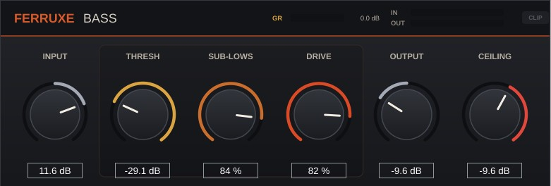

# FerruxeBass

**FerruxeBass** é un plugin directo para darlle peso, corpo e ese punto xusto de *ferruxe* e agarre ao baixo eléctrico. Inspirado en pedáis tipo **SansAmp**, mantén uns graves firmes que asentan a mestura mentres engade carácter.




## Controis

`INPUT` ➔ `THRESH` ➔ `SUB-LOWS` + `DRIVE` ➔ `OUTPUT` ➔ `CEILING`

* **Input (`-24` a `+24 dB`):** Ganancia de entrada para axustar con canta forza o baixo empuxa o circuíto.
* **Thresh (`-40` a `0 dB`):** Compresor previo á distorsión que iguala o toque de púa ou dedos para que todas as notas soen firmes.
* **Sub-Lows (`0` a `100 %`):** Engade corpo e harmónicos graves para que o baixo se sinta fondo mesmo en altofalantes pequenos.
* **Drive (`0` a `100 %`):** Saturación con carácter estilo *SansAmp* que achega ruxido, ataque e ese agarre metálico sen apagar o subgrave limpo.
* **Output (`-24` a `+24 dB`):** Volume xeral de saída.
* **Ceiling (`-24` a `0 dB`):** Recortador (*hard clipper*) final para domar os picos rebeldes e cravar o teito de saída.

## Formatos e Compilación (Linux)

Desenvolvido en C++20 con **JUCE**. Xera formatos nativos **LV2**, **VST3** e **Standalone** (JACK / PipeWire / ALSA).

```bash
cmake -B build -G Ninja -DJUCE_DIR="$HOME/opt/JUCE"
cmake --build build --parallel
```

# Desenvolto como proxecto educativo
Primeiro achegamento ao desenvolvemento de VSTs apoiado por modelos de lenguaxe
Pido perdón aos developers de c++ por esta aberración


# FerruxeBass (ENG)

**FerruxeBass** is a straightforward plugin designed to bring weight, body, and just the right amount of grit, bite, and *rust* to electric bass. Inspired by **SansAmp**-style pedals, it locks down a solid low end that anchors the mix while adding distinct character.


## Controls

`INPUT` ➔ `THRESH` ➔ `SUB-LOWS` + `DRIVE` ➔ `OUTPUT` ➔ `CEILING`

- **Input (`-24` to `+24 dB`):** Input gain to dial in how hard the bass pushes the circuit.
- **Thresh (`-40` to `0 dB`):** Pre-distortion compressor that evens out pick or finger dynamics so every note lands consistently.
- **Sub-Lows (`0` to `100 %`):** Adds low-end body and sub-harmonics so the bass feels deep even on smaller monitors.
- **Drive (`0` to `100 %`):** Character-rich *SansAmp*-style saturation delivering growl, attack, and metallic bite without muddying the clean low sub.
- **Output (`-24` to `+24 dB`):** Overall output level.
- **Ceiling (`-24` to `0 dB`):** Final hard clipper to tame stray peaks and firmly lock down the output ceiling.

## Formats & Compilation (Linux)

Developed in C++20 using **JUCE**. Generates native **LV2**, **VST3**, and **Standalone** formats (JACK / PipeWire / ALSA).

```bash
cmake -B build -G Ninja -DJUCE_DIR="$HOME/opt/JUCE"
cmake --build build --parallel

```

# Developed as an educational project

First venture into VST development assisted by language models.

My sincerest apologies to C++ developers for this monstrosity.


